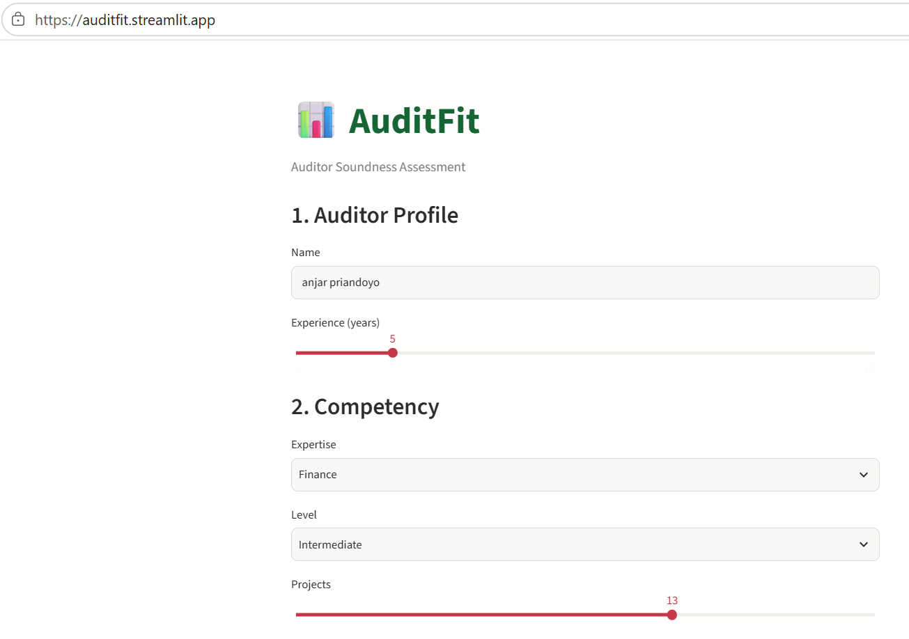
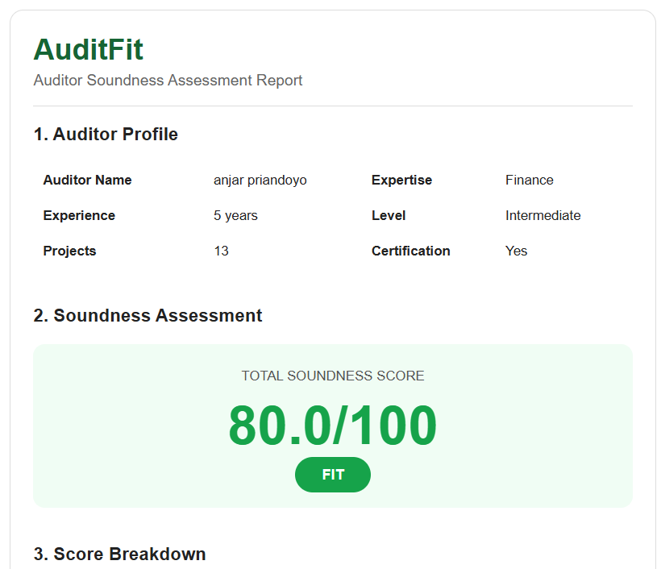

# AuditFit – Auditor Soundness Assessment

**A rule-based auditor competency and suitability assessment system built with Python and Streamlit.**

<p align="center">
  <a href="https://auditfit.streamlit.app/">
    
  </a>
  <a href="https://github.com/priandoyo/auditfit">
    
  </a>
</p>

AuditFit is a lightweight web application that demonstrates how an auditor's professional suitability can be assessed through a transparent, weighted scoring model.

It evaluates four dimensions:

1. Professional Experience
2. Technical Expertise
3. Project Exposure
4. Professional Certification

The application calculates an overall soundness score, classifies the auditor into one of four suitability categories, and provides an assessment recommendation.

## 1. Live Application

**Try AuditFit:** https://auditfit.streamlit.app/

**Source Code:** https://github.com/priandoyo/auditfit

## 2. Application Screenshots

### 2.1 Auditor Assessment Interface

The assessment interface captures the auditor profile and competency inputs used by the scoring engine.



### 2.2 Assessment Results Dashboard

The results dashboard displays the calculated soundness score, classification, dimension-level scores, weighted contributions, and recommendations.



## 3. Key Features

1. **Auditor Profiling** – Capture auditor name, years of experience, expertise domain, competency level, project exposure, and certification status.
2. **Weighted Scoring Engine** – Calculate a composite score across four assessment dimensions.
3. **Automated Classification** – Categorize results as Highly Fit, Fit, Conditionally Fit, or Not Yet Fit.
4. **Interactive Dashboard** – Present overall results and individual competency scores.
5. **Transparent Methodology** – Provide visibility into scoring weights, criteria, and classification thresholds.
6. **Web-Based Interface** – Access assessments through a browser without installing desktop software.

## 4. Assessment Methodology

AuditFit uses an illustrative weighted scoring model with a maximum score of 100 points.

### 4.1 Scoring Weights

| Assessment Dimension | Weight |
|---|---:|
| Professional Experience | 25% |
| Technical Expertise | 30% |
| Project Exposure | 30% |
| Professional Certification | 15% |
| **Total** | **100%** |

### 4.2 Scoring Criteria

**A. Professional Experience**

| Experience | Score |
|---|---:|
| Below 1 year | 0 |
| 1–2 years | 40 |
| 3–4 years | 60 |
| 5–9 years | 80 |
| 10 years or more | 100 |

**B. Technical Expertise**

| Competency Level | Score |
|---|---:|
| Basic | 25 |
| Intermediate | 50 |
| Advanced | 75 |
| Expert | 100 |

**C. Project Exposure**

| Number of Projects | Score |
|---|---:|
| 0 | 0 |
| 1 | 25 |
| 2–3 | 50 |
| 4–5 | 75 |
| More than 5 | 100 |

**D. Professional Certification**

| Certification Status | Score |
|---|---:|
| No | 0 |
| Yes | 100 |

### 4.3 Calculation Formula

The overall soundness score is calculated using the following formula:

**Soundness Score =**

(Experience × 25%) + (Expertise × 30%) + (Projects × 30%) + (Certification × 15%)

Each dimension is first converted into a score between 0 and 100. The weighted contributions are then added to produce the final score.

### 4.4 Assessment Classification

| Score Range | Classification | Recommendation |
|---|---|---|
| 85–100 | HIGHLY FIT | Suitable for senior audit assignments |
| 70–84 | FIT | Suitable for regular audit assignments |
| 50–69 | CONDITIONALLY FIT | Additional supervision and competency development recommended |
| Below 50 | NOT YET FIT | Further competency development required |

## 5. Technology Stack

| Component | Technology |
|---|---|
| Programming Language | Python |
| Web Framework | Streamlit |
| User Interface | Streamlit |
| Dashboard Rendering | HTML and CSS |
| Application Deployment | Streamlit Community Cloud |
| Source Code Management | GitHub |

## 6. Project Structure

```text
auditfit/
│
├── app.py              # Main application and scoring engine
├── requirements.txt    # Python dependencies
├── auditfit1.png       # Assessment interface screenshot
├── auditfit2.png       # Results dashboard screenshot
└── README.md           # Project documentation
```

## 7. Installation and Execution

### Prerequisites

- Python 3.10 or later
- pip
- Git

### Step 1. Clone the Repository

```bash
git clone https://github.com/priandoyo/auditfit.git
cd auditfit
```

### Step 2. Install Dependencies

```bash
pip install -r requirements.txt
```

### Step 3. Run the Application

```bash
streamlit run app.py
```

### Step 4. Access the Application

Open your browser and navigate to:

```text
http://localhost:8501
```

## 8. Potential Future Enhancements

1. **Competency Framework Alignment** – Map assessment dimensions to recognized professional and IT audit competency frameworks, including IIA and COBIT.
2. **Expanded Competency Model** – Include audit methodology, communication, professional judgment, independence, and domain-specific skills.
3. **Team Analytics** – Compare competency profiles and identify development needs across audit teams.
4. **Assessment History** – Track assessment results and competency development over time.
5. **Automated Reporting** – Generate downloadable PDF assessment reports.
6. **AI-Assisted Assessment** – Explore AI-assisted competency analysis and personalized development recommendations.

## 9. Disclaimer

AuditFit is a demonstration and decision-support prototype. Its scoring weights, thresholds, and criteria are illustrative and have not been established as a validated professional standard.

The assessment results should not be interpreted as a definitive determination of an auditor's professional competence or authorization to perform audit assignments.

Actual organizational adoption should involve appropriate validation, calibration, governance, and human review.

## 10. Author

**Anjar Priandoyo**

Technology, IT Governance, Risk Management, and Digital Transformation Practitioner.

- GitHub: https://github.com/priandoyo
- Project: https://github.com/priandoyo/auditfit
- Live Application: https://auditfit.streamlit.app/

---

*AuditFit – Turning Auditor Competency into Measurable Assessment.*
